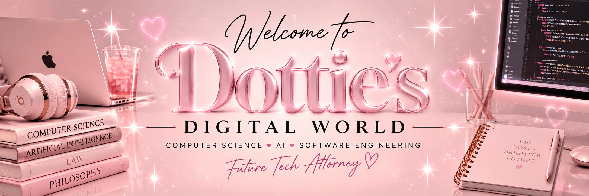

  

<h1 align="center">✨ Hi, I'm Dottie! 💗</h1>

  💻 Computer Science Student | 🤖 Aspiring Software Engineer | ⚖️ Future Tech Attorney

Welcome to my little corner of GitHub! 💕

I'm a Computer Science and Philosophy student at Southern Illinois University Edwardsville (SIUE), passionate about exploring the intersection of technology, artificial intelligence, and law.

I'm currently building my programming skills, exploring new technologies, and creating projects that challenge me to grow as a developer.

💻 What I'm Learning

  
  
  
  
  

🤖 Artificial Intelligence

📊 Data Science

📚 My Goals

Build meaningful software projects.

Gain hands-on experience through technical internships.

Explore AI and software engineering.

Eventually combine my technology background with a career in law.

✨ A Little About Me

🎓 Double majoring in Computer Science & Philosophy

💗 Passionate about technology, learning, and personal growth

🧩 Building my developer journey one project at a time

📩 Let's Connect!📥

I'm always excited to learn, collaborate, and connect with others in tech!
